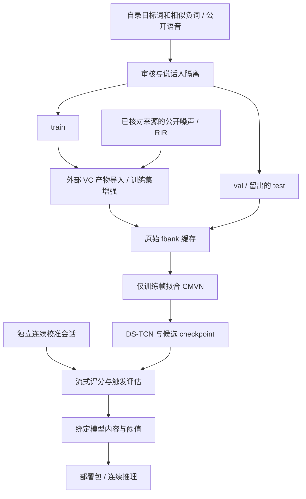

# EasyKws 技术报告：自定义唤醒词工具链与工程复盘

[文档首页](README.md) · [操作教程](tutorial.md) · [来源与许可证](DATA_PROVENANCE.md)

本文说明 EasyKws 为什么采用当前方案、各阶段怎样衔接，以及实际开发中哪些问题值得复用。阅读时可以先看系统流程和设计取舍，再沿文末的代码地图深入实现。具体命令放在操作教程，字段和边界放在参考文档。

本文的工程经验来自既有项目的录音、扩充、训练和实时检测实践，按当前通用实现重新组织。历史原始数据、模型权重、业务词和内部指标不随仓库公开；历史经验不自动成为当前开源版的效果结论。下面明确标注尚未迁入的功能。

## 1. 要解决的问题

EasyKws 的出发点是：让个人和小团队也能为自己的设备或应用定制唤醒词。使用者自己选词，找几位朋友录制目标词及容易混淆的对照词，再结合公开语音和声学资源完成训练与验证。采集精力集中在特定词语上，其余背景覆盖利用已有资源补充。

为实现这一目标，项目同时整理采集任务、数据处理、训练与连续运行之间的衔接，减少使用者从零拼接各环节的工作。当前仍按独立说话人及同源关系组织训练、验证和测试；具体约束见第 3 节和[录制指南](recording_guide.md)。

唤醒词系统持续接收音频，判断用户是否说出了指定短语。它的困难不只在于把正负录音分开：用户会换人、换距离、换音量；普通讲话中可能出现近音词；模型即使在单条录音上给出了高分，连续监听时仍可能漏报、重复报告或误报。

本项目采用「数据准备 → 模型训练 → 连续流校准 → 独立运行」的路线。目标是让每个环节有可检查的输入输出，并且让阈值、前端和触发策略与实际模型保持一致。它不是新的网络架构论文，也没有声称优于现有开源 KWS 系统。

| 设计选择 | 解决的问题 | 代价或限制 |
| --- | --- | --- |
| 自录目标词与易混淆词，结合公开资源和扩充 | 把采集精力放在具体词语上，利用已有资源补充背景条件 | 资源选择和审核仍需投入，不能替代现场实录 |
| 因果 DS-TCN 与连续缓存 | 按新到达的帧持续评分 | 状态与会话边界必须正确管理 |
| 波形增强与 SpecAugment 分工 | 声学条件及特征扰动的覆盖 | 增强参数要匹配场景，变体并非独立人员 |
| 按流式事件校准 | 片段高分与真实触发行为不一致 | 需要额外的连续录音和时间标注 |
| 严格记录运行与部署身份 | 模型、CMVN、阈值或执行环境错配 | 搬迁到不同环境时通常需要重新校准 |

## 2. 整体流程与数据形状



留出的 test 只参与数据完整性检查，不参与训练、候选选择或阈值选择。当前工具尚未提供独立的最终连续测试报告命令，需要另行制定并记录测试协议。

训练侧的数据变化如下：

```text
一条单声道波形 [N]
    → 40 维 fbank [T, 40]
    → batch 补齐 [B, Tmax, 40]，另带有效长度 [B]
    → 模型内 CMVN、线性投影、因果时序卷积
    → 每帧概率 [B, Tmax, 1]
    → 在有效帧上计算损失
```

推理侧保留残余音频和网络上下文，只对新产生的完整帧评分。模型分数再交给触发器，输出带音频时钟的事件。块长是传输方式，帧长和模型上下文才是计算契约。

## 3. 数据：数量之外还要看覆盖与关系

### 3.1 先确定标签，再设计采集

「完整目标词」「简称」「近音词」的标签来自预先确定的使用需求。一个容易误触发的词，不应为了得到更好看的结果而临时改成正例，或者从报告中无痕删除。应保留原记录、说明新策略，再生成新的输入版本。

正样本以自录目标词为基础，尽量覆盖自然语气、语速、音量、距离、方向，以及目标词后接指令的情况；近音词和相似词负样本也宜针对目标词自行录制。普通语音、音乐、环境噪声和房间脉冲响应（RIR）可按来源与许可证选用公开数据，减少全部自行采集的负担。负样本不能只靠静音与少数固定词句。公开资源用于补充训练条件；实际连续校准和现场验证仍需另行采集并标注适合目标场景的录音。操作任务见[录制指南](recording_guide.md)。

### 3.2 先划分，再扩充

同一个人的多个编号、同一原始文件的多个切片、同一父样本的多个 VC 或增强变体不能被当作独立数据随机分散。项目保留说话人、原始录音和父子关系，用它们共同约束划分。关联关系连在一起的数据构成一个来源单元；当前要求至少三个独立单元，并将数据分到训练、验证和测试集。对已知说话人，单人的多条录音或变体不会因此变成多个独立单元。排除的中间记录也保留关系，避免把一条同源链拆开。

资源也会泄漏信息。测试人员的音色不能用作训练 VC 参考，评估音频不能换一个 WAV 封装后当作训练噪声。当前实现结合声明关系、文件哈希和可核实的 PCM 身份检查已知冲突；它无法识别一切变速、重采样或其他近重复，完整来源仍需使用者记录。

### 3.3 VC 和信号增强解决不同问题

| 方法 | 历史实践中的用途 | 当前开源版 |
| --- | --- | --- |
| Seed-VC 音色转换 | 从已有目标词扩展音色覆盖 | 导入已生成且审核通过的 VC 产物，不运行生成引擎 |
| 波形增强 | 改变音量、时间尺度、噪声、混响或频带条件 | 提供五类离线增强 |
| SpecAugment | 在训练时遮挡部分时间和频率特征 | 训练读取特征后执行 |

音色变化不能自动带来新的发音习惯、词边界或设备响应。生成成功也不等于数据可用：仍要检查截断、长静音、词句错误、异常尾音及重复内容。当前导入器核对 QC 决策和对应文件身份，不会替人完成全部声学审核，也不根据文件存在就宣布 QC 通过。

公开负样本与训练资源的来源见[来源与许可证](DATA_PROVENANCE.md)。本机元数据适配器保留官方划分和原始类别，不把未知说话人伪造成已完成隔离的真人身份。

## 4. 特征、归一化与增强

### 4.1 固定前端，CMVN 只应用一次

当前前端调用 `torchaudio.compliance.kaldi.fbank`：16 kHz 单声道，25 ms 窗、10 ms 帧移、40 个 mel bin。Povey 窗、预加重、去直流和 dither 等参数显式固定，详见[前端参考](reference/preprocessing.md)。

对 N 个样本点，完整帧数为 `1 + floor((N - 400) / 160)`，训练样本不足一帧时拒绝。缓存保存 float32 的原始 fbank；CMVN 在模型内应用一次：

`normalized[t, f] = (features[t, f] - mean[f]) * istd[f]`

启用方差归一化时使用上述完整变换，关闭时只减均值。统计仅来自实际输出的训练帧，包括纳入的训练变体，验证和测试不参与拟合。这样评估不会提前利用留出数据的统计信息，也避免缓存和模型内重复归一化。

### 4.2 离线增强与特征遮挡

| 增强 | 当前实现要点 | 需要注意 |
| --- | --- | --- |
| gain | 波形乘以幅度系数 | 不是按目标 dBFS 分档的在线增强 |
| speed | 按指定速度比做多相重采样，改变时长 | 不是保持音高的时间拉伸 |
| noise | 按当前波形 RMS 和目标 SNR 混合资源片段 | 记录重复、选段与资源身份 |
| RIR | 与脉冲响应卷积，去主峰前延迟，保留尾音并按参考 RMS 缩放 | 声学条件取决于实际 RIR |
| filter | 四阶 Butterworth 带通，使用 SOS 滤波 | 不等于复现任意麦克风响应 |

clean 不暗中做峰值归一化。非空操作链在完成后统一做峰值保护；操作顺序影响结果，应随变体记录。regular 是单操作变体，challenge 是两种不同操作按抽取顺序组合。只增强匹配条件的 train 数据，val/test 保持 clean。

训练时 SpecAugment 复制缓存特征再做时间/频率遮挡，不改磁盘缓存，也不重新拟合 CMVN。波形增强发生在 fbank 前，特征遮挡发生在训练读取后，两者不能混为同一处理。

### 4.3 为什么默认保留全长

历史处理中，长负录音只保留一次确定性短裁剪，会使其余内容长期没有被训练看到。之后即使修复训练端裁剪，预处理已经丢掉的内容也不会回来。

当前预处理和训练默认保留完整有效长度。历史短裁剪仅作为显式兼容选项，并记录保留和丢弃区间。实际覆盖还取决于有放回抽样，所以要同时看「缓存中有哪些帧」和「训练实际读过哪些样本」。

### 4.4 历史在线目标音量增强：尚未迁入

历史实践曾使用训练时在线波形增益增强：测量输入的活跃段音量，抽取目标 dBFS 区间，在增益和峰值限制下变换波形，再重新提取特征；正负样本使用一致策略。这与离线幅度乘法在策略和成本上都不同。

这段经验说明：推理前端的 AGC 可能同时抬高正样本和背景扰动，不能把现场所有问题都归因于「声音太小」。同一输入、不同前端的对照更有助于定位问题。简单给 log 特征加常数也不必然等价于真实增益后的 fbank，因为还存在数值下限、滤波和峰值保护等条件。

当前开源版没有在线目标音量增强，也不包含历史软件 AGC。这里只解释路线和经验，不提供未经本版本验证的配方参数或历史收益数字。

## 5. 模型、损失与训练曝光

### 5.1 为什么使用因果 DS-TCN

模型及部分训练实现来自留存的 WeKWS 派生代码。当前网络在 CMVN 后做线性投影，经带残差的因果深度可分离卷积，再用线性层与 sigmoid 输出单关键词分数。因果卷积只使用当前与过去帧，适合保持状态的逐帧推理。

深度卷积按通道处理时间关系，逐点卷积混合通道；膨胀卷积扩大历史覆盖。默认 4 层的 dilation 为 1/2/4/8，kernel_size=8，时序感受野为 `1 + (8-1)*(1+2+4+8) = 106` 帧。它表示网络历史上下文，不等于总唤醒延迟。默认规模可以配置；小型冒烟模型不代表正式模型的容量选择。

项目没有建立与其他架构的公开同条件对照，因此采用这种网络是实现与流式需求的选择，不是已证明的性能最优结论。历史上游 commit/tag 未记录，来源边界见[模型记录](reference/MODEL_PROVENANCE.md)。

### 5.2 最大池化损失怎样使用句级标签

训练标签 `0` 表示目标词，`-1` 表示非目标。令 `p_t` 为有效帧上的目标概率，基础形式为：

- 正样本：`L_pos = -log(max_t p_t)`，要求至少有一个位置对目标词给高分。
- 负样本：`L_neg = -log(1 - max_t p_t)`，惩罚整段中最高的误触发倾向。

实现有概率截断以保持数值有限；正样本可用 `min_duration` 排除初始若干帧，但必须仍有有效帧。padding 不参与最大值与损失池化。网络保留 BatchNorm，因此池化掩码正确并不意味着训练模式下任意 padding 都不会影响网络统计。

这是一种句级监督方法，不直接提供目标词时间对齐；高分出现的位置和持续时间仍需在连续校准中检查。训练准确率使用固定的严格 0.5 比较，也不能直接替代可配置比较符的部署结果。

### 5.3 epoch 不等于遍历数据集

当前训练实现使用 CPU 和 FP32，训练成本会随数据量、序列长度和模型规模变化。这里关注数据实际被看到的机会，因为增强得到更多文件并不意味着训练过程均匀看过每一条。

组 g 的总权重 `W_g` 平分给其中 `n_g` 个样本，单条未归一化权重为 `W_g / n_g`。有放回抽样使组概率由组权重控制，但一轮可能重复读某些样本，也可能漏掉其他样本。轮内实际比例也不要求恰好等于理论概率。

同一父录音增加多个 VC 或增强变体后，其总曝光概率可能增加；当前默认是样本级均衡，不是父录音级均衡。比较不同扩充方案时，应同时报告抽样次数、更新次数、组/父样本曝光和有效帧，不能只比较训练了多少 epoch。

训练保存完整轮末的模型、优化器、调度器与随机状态；轮中失败后重做该轮。`best_val_loss` 是验证损失最优候选，不自动成为最终部署模型，模型和阈值都在后续校准阶段选择。

## 6. 从逐帧分数到一次唤醒

### 6.1 连续缓存和音频时钟

音频块大小可以是 160、512 或更多样本点。前端累积到一个完整窗才产生新帧，并保留下一帧需要的重叠和残余样本；网络则保留因果上下文。重复计算同一历史窗口中的最大峰，容易把旧高分再次报告成新事件。

当前事件只消费新帧。帧时间取完整帧的结束时间，尾部不足一帧不补零。有效数字静音正常推进音频时钟与状态；设备丢块是缺少观测，不能用静音补齐，两次观测之间应重置为新会话。

### 6.2 触发状态机

默认规则为连续 3 帧确认、50 帧热身、低分持续 0.3 秒重新就绪和 2 秒冷却；阈值单独校准。这些是当前默认设置，使用者应按真实验证条件评估其取舍。

同一激活段只报告一次，即使高分持续超过冷却时间也不重复触发。必须经过规定的低分区间，才重新具备触发资格。确认要求作用于新帧，完整规则见[校准参考](reference/calibration.md)。

多帧确认可以过滤短促高分，也会过滤真实但短促或断续的目标词高分。3 帧相对单帧最早增加两个帧移的确认等待；这不是从用户发声到设备回应的总延迟。阈值、确认帧数和冷却应一起评估。

### 6.3 片段评估与连续 FAH

`evaluate` 对每条验证样本取最大分，回答片段是否被分类为正例。连续校准则在共享触发器输出的事件上评分：每个正例窗口的首次事件计命中，负区间内事件计误触发，未标注区间单独记录。

`FAH = 负区间内误触发事件数 / 已标注负区间小时数`

因此，一条负样本误判比例不能直接换成每小时误触发。短录音上零误触发也不能证明长期 FAH 达标。窗口范围、会话重置、静音计时和实际负时长都是指标的一部分，需要和数字一起报告。

## 7. 模型与阈值为什么一起导出

同一结构可以有不同权重，同一权重可以配错 CMVN，同一模型也可能在不同前端或执行精度下产生不同分数。仅给几个文件分别计算 SHA256，并不能证明它们本来就是一套。

本项目的校准记录绑定实际权重和持久缓冲区的内容摘要、结构、CMVN、前端、触发规则、执行配置、实现代码与校准输入。导出重新核对来源，受限重存后再加载模型，并回放全部校准会话核对分数和事件。

checkpoint 容器文件的哈希用于识别来源，推理内容摘要用于判断重新封装是否保持同样的模型内容。换模型、改 CMVN 或改线程/精度等配置不能靠重算外层哈希来沿用校准。

部署包由模型、CMVN、阈值、校准记录、manifest 和最后写入的 READY 组成，不携带训练音频、特征和逐帧历史。运行时只需完整包与匹配的软件环境。测试或诊断用途会传播到包，默认拒绝按普通模型加载；显式允许测试用途也不会跳过内容一致性核验。

这些机制防止无意错配和工具链静默丢失用途信息，不是数字签名，也不能认证一个手工伪造包的真实来源。受限 checkpoint 加载同样不能替代来源核实。

## 8. 已有证据与当前不能承诺的结论

| 证据 | 当前能支持什么 | 不能据此推出什么 |
| --- | --- | --- |
| 单元与反例测试 | 指定规则、异常拒绝和状态恢复按预期工作 | 真实语音唤醒效果 |
| 留存实现与迁移实现的数值对照 | 指定输入、参数和环境中的计算语义一致 | 上游 commit 已确认、历史训练已完整复现 |
| 合成完整链路 | 数据到部署包能够衔接，新进程回放一致 | VC 引擎已运行、模型能识别真人语音 |
| Windows 干净环境安装 | 已检查环境中 wheel/sdist 路径可运行 | Linux 或所有 Python 版本已通过 |
| 模拟设备测试 | 回调、异常、队列与清理路径有覆盖 | 真实麦克风兼容或长期稳定运行 |

当前主仓工具链已验证范围为 Windows / Python 3.12 / CPU FP32。Linux、Python 3.10/3.11 和远程 CI 尚待执行；主仓 `easykws-listen` 的真实麦克风行为尚待设备验证。另有既有方案的 ESP32-S3 实机实践，见下节。报告不把 CI 配置存在写成 CI 已通过，也不使用测试项数量替代效果。

真实性能评估还需要固定目标用户与设备、独立人员和场景、足够长的连续负音频，以及明确的正例时间标注。记录命中、漏检、重复、误触发与实际时长，再讨论可接受阈值。当前工具链不复现历史最终训练配方或效果数字；历史结果不默认迁入，参见[历史结果边界](reference/HISTORICAL_RESULTS.md)。

### 8.1 ESP32-S3 端侧部署实践

既有 DS-TCN 方案还完成过独立的 ESP32-S3 移植，覆盖模型计算、板端特征和真实麦克风输入。它补充了桌面验证之外的一条证据：该结构在所选微控制器配置上能够完成本地实时处理。本节依据留存源码、阶段报告、分数文件与串口记录整理，本轮没有重新编译、烧录或测量。

#### 部署路线

硬件采用 ESP32-S3（16 MB Flash、8 MB PSRAM）与 INMP441 数字麦克风，另接 ST7789 状态屏。实时链路为：

```text
I2S 16 kHz 采音
    → 板端 Kaldi 风格 fbank（400/160 点、40 维）
    → 显式 CMVN
    → 8 帧一批的 FP32 DS-TCN，保留因果缓存
    → 逐帧触发器
    → 本地唤醒事件及状态显示
```

部署没有依赖 INT8 量化，也没有把桌面 `.pt` 文件直接交给芯片。PC 侧先折叠推理模式下的 BatchNorm，导出 FP32 权重、CMVN、mel 滤波器和窗口参数；板端以 C/C++ 实现对应运算。权重放入 PSRAM，缓存和激活按板端内存安排。

这保留了模型、前端与触发策略的整体思路，但仍需针对板端数值实现重新验证。当前 EasyKws 的部署包格式与该独立固件的权重布局不同，不能直接互换。

#### 为什么成批推理还能逐帧触发

模型算力测试比较过不同批大小。逐帧调用的开销较大，采用 8 帧批处理后，再按时间顺序逐一更新触发器，保持确认、去重和冷却语义。不能只拿一批分数的最大值判断是否触发。

每帧间隔 10 ms，8 帧对应 80 ms 的数据周期。现存一份短时实时日志中，模型推理 p99 约 50 ms/批；这为所测配置的持续处理提供了依据，但不等于总唤醒延迟只有 50 ms。攒帧、特征、模型上下文、确认规则和状态报告都会影响最终时延。

采音与特征处理、模型推理分别安排在两个任务中，通过帧队列衔接。I2S 的槽位、24 bit 输入到模型幅值的转换，以及 fbank 的窗函数和尺度都需要逐项对照，不能只因帧数相同就认定输入一致。

#### 现有记录支持什么

| 验证内容 | 记录支持的结论 | 证据范围 |
| --- | --- | --- |
| 固定 PCM 经过板端 fbank、模型和触发器 | 选定样例的分数在规定数值容差内与 PC 参考一致，事件匹配 | 少量固定样例，不是识别率测试 |
| 真实麦克风采音及特征 | 已有 60 秒探针记录，帧数符合样本时钟，无读错误和短读 | 采集与特征阶段，不等于模型全链路时长 |
| 真实采音、特征与模型持续运行 | 现存 20 秒日志中，1998 个特征帧全部进入推理，队列丢帧、读取错误和超时为零 | 一次短时调度验证，不证明长期稳定性或 FAH |
| 自动监听与状态屏 | 已有集成、构建和烧录记录 | 正式的真人唤醒与视觉效果确认在阶段记录中仍待补全 |

采集探针与完整模型链路是不同实验，上述时长分别报告，不能叠加成一次更长的连续运行。完整链路采用能与现存串口记录对应的 20 秒作为依据。

已有用户试用备注反映了近距离和启动阶段仍需调试。进一步应核对麦克风电平、设备声学条件与冷启动行为，补充独立说话人、远场和长时连续评估。芯片具备本地推理能力，不意味着整机已经完成低功耗、续航或产品可靠性验收；当前材料没有整机功耗测量。

#### 与当前开源仓库的关系

这项工作说明既有模型路线具有 ESP32-S3 端侧落地的可行性。它不是对当前 EasyKws 新训练模型、导出格式或全部硬件配置的兼容承诺。固件、模型导出适配和板端构建流程尚未迁入本仓库；本节也不分发原模型、录音、参考向量或原始日志。

若后续接入，需把新的模型结构、CMVN、前端与触发配置统一转换为板端资源，再重新做固定向量、真实采音、算力、内存与功耗验证，不能只沿用旧模型阈值。

## 9. 项目价值与后续方向

本项目的价值在于把数据、训练、校准和连续运行之间容易被忽略的约定落实到一条可复查的流程中：既关注模型，也关注样本实际曝光、来源关系、触发行为和部署错配。

当前还存在清楚的取舍：没有预训练模型；没有外部生成引擎；目标词及近音对照需要组织录制和审核，普通语音与声学资源可选用符合许可的公开数据；真实连续校准与现场验证仍需要相应录音和标注；在线目标音量增强尚未纳入；严格环境绑定增加了跨环境复用成本；主仓实时入口不重采样，独立 ESP32-S3 路线尚未接入自动导出，量化也尚未验证。

后续工作应优先用真实数据补足效果证据和设备验证，再决定增加音量增强、并行预处理或其他模型形式。优化前分别测量 I/O、波形处理、特征与模型计算成本，避免为了速度改变了数据或评分语义。

## 10. 代码阅读路线

| 顺序 | 文件 | 关注的问题 |
| --- | --- | --- |
| 1 | [model.py](../src/easykws/training/model.py) | 特征形状、CMVN、卷积和缓存怎样连接 |
| 2 | [loss.py](../src/easykws/training/loss.py) | 有效帧和句级标签怎样进入损失 |
| 3 | [augment.py](../src/easykws/preprocess/augment.py)、[frontend.py](../src/easykws/preprocess/frontend.py) | 波形如何变成训练特征 |
| 4 | [sampling.py](../src/easykws/training/sampling.py)、[runner.py](../src/easykws/training/runner.py) | 抽样、训练与恢复怎样执行 |
| 5 | [streaming.py](../src/easykws/streaming.py)、[trigger.py](../src/easykws/trigger.py) | 新帧怎样变成事件 |
| 6 | [calibration/core.py](../src/easykws/calibration/core.py)、[binding.py](../src/easykws/calibration/binding.py) | 候选与阈值怎样选择、绑定 |
| 7 | [export/core.py](../src/easykws/export/core.py)、[runtime/api.py](../src/easykws/runtime/api.py) | 已选模型怎样交给独立运行入口 |

第一次阅读可以先顺着输入输出走，再看异常检查和测试。更细的来源、官方项目链接及许可证见[来源与许可证](DATA_PROVENANCE.md)和[第三方说明](../NOTICES.md)。
